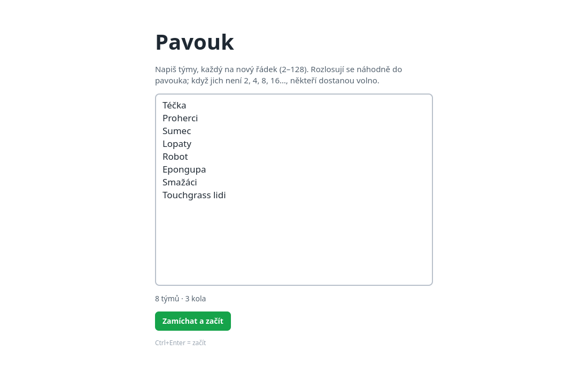
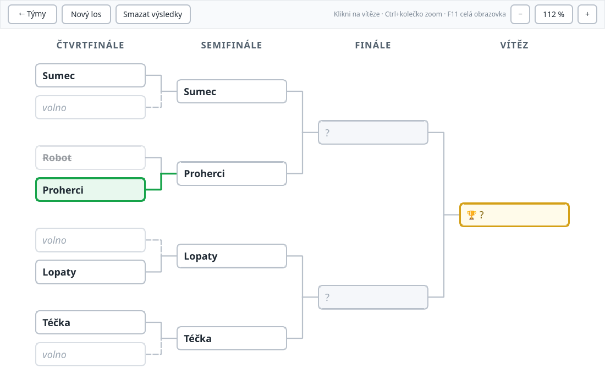

# Pavouk

Clickable tournament bracket (*pavouk*) for any number of teams (2–128). Type the team names, the app shuffles them randomly into the bracket, and you click the winner of each match. Czech UI, PySide6 + QML.

 

- **Intro screen:** type the teams, one per line (or paste a list), then **Zamíchat a začít** (or Ctrl+Enter).
- **Any number of teams:** when it isn't 2, 4, 8, 16…, some teams get a bye (*volno*) and go straight to round 2.
- **Click a team** to make it win the match and advance; click it again to undo. Changing an earlier result clears the later matches that depended on it.
- **Big brackets** scroll; Ctrl+mouse wheel or −/+ zooms, the % button fits it back. **F11** = fullscreen (projector).
- Results save automatically; the app reopens where you left off. **← Týmy** goes back to the names, **Nový los** re-draws the same teams, **Smazat výsledky** clears the results (both ask with a second click).

## Download (Windows)

Grab `Pavouk.exe` from the [latest release](../../releases/latest). No install needed. Windows SmartScreen may warn because the exe is unsigned: *More info → Run anyway*.

## Run from source

```bash
pip install PySide6-Essentials
python -m pavouk                          # window
python -m pavouk --los tymy.txt           # draw a bracket from a file and print it
python -m pavouk --vypis --stav stav.json # print a saved tournament
```

Tests: `pip install pytest pytest-qt && QT_QPA_PLATFORM=offscreen pytest`.

License: MIT.
